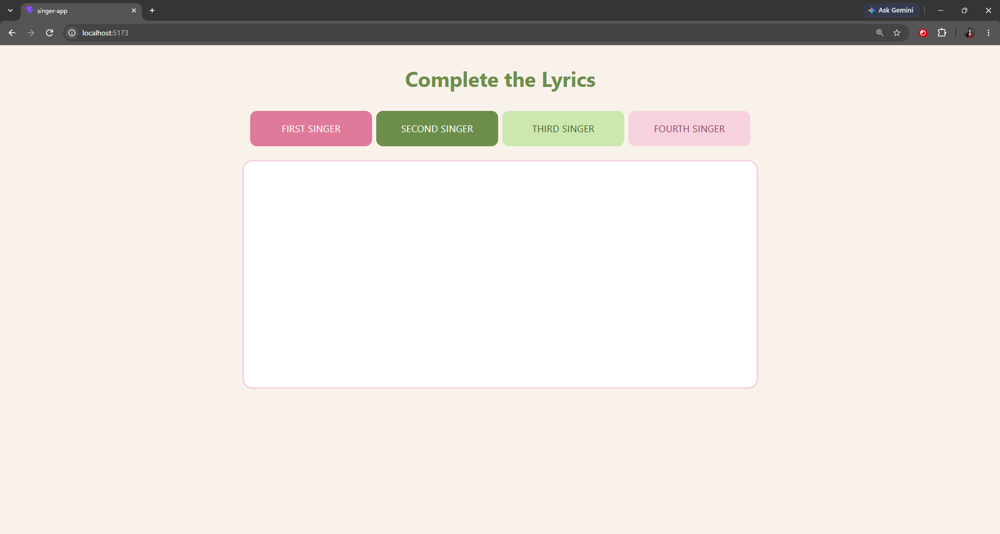
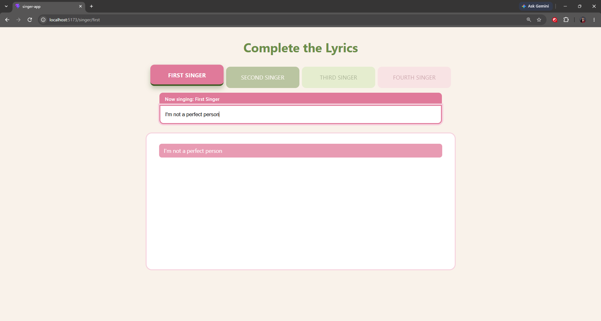
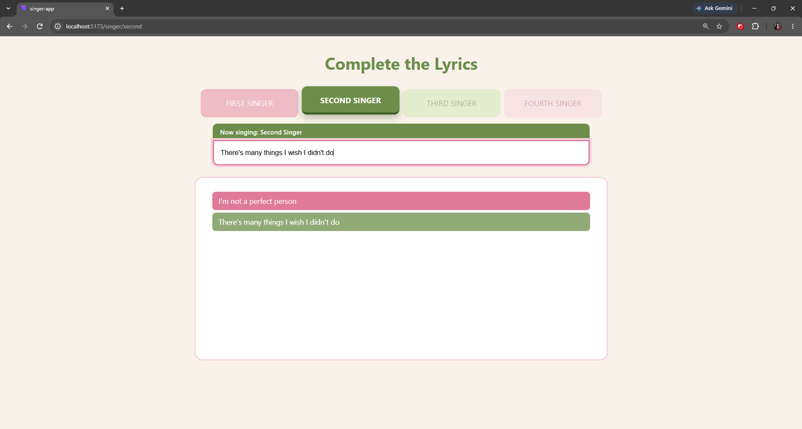
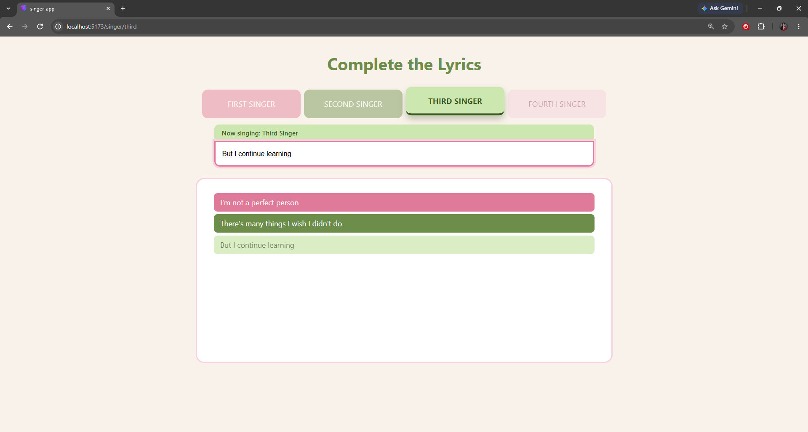
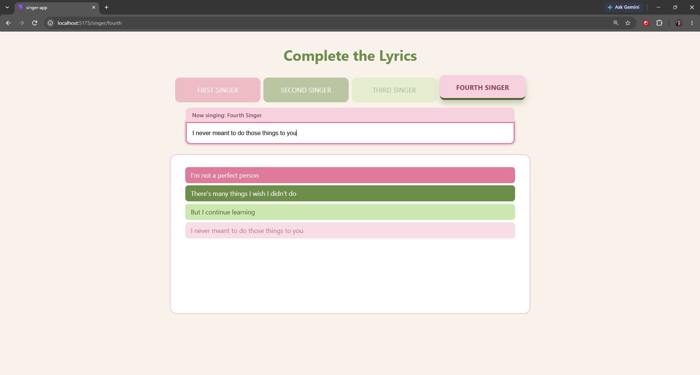

# Complete the Lyrics

A React Router laboratory activity. Each singer button navigates to its own URL, and the page is rendered by one reusable component.

## Tech Stack

- React (Vite)
- react-router-dom

## Installation

```bash
npm install
```

## Run

```bash
npm run dev
```

Then open http://localhost:5173/singer

## Routes

| Path | View |
| --- | --- |
| `/` | Home: title and four singer buttons |
| `/singer` | Same as home |
| `/singer/:singerId` | Singer page (`first`, `second`, `third`, `fourth`) |
| `/singer/unknown` | "Singer Not Found" message with Home link |
| `*` | 404 Not Found page with Home link |

## Project Structure

```
src/
  main.jsx               BrowserRouter setup
  App.jsx                Route definitions
  index.css              Styles
  data/singers.js        Singer data (id, name, color)
  components/SingerNav.jsx   NavLink buttons
  pages/Layout.jsx       Shared layout (title, buttons, lyrics box)
  pages/SingerPage.jsx   Reusable singer page (uses useParams)
  pages/NotFound.jsx     404 page
```

## Screenshots

<!-- ### Home page (`/singer`)


### First singer (`/singer/first`)


### Second singer (`/singer/second`)


### Third singer (`/singer/third`)


### Fourth singer (`/singer/fourth`)
 -->

## How `useParams` Works

The route `/singer/:singerId` contains a dynamic segment. When the URL is `/singer/second`, React Router stores `singerId = "second"`. Inside `SingerPage`, calling `useParams()` returns that value:

```jsx
const { singerId } = useParams();
const singer = singers.find((s) => s.id === singerId);
```

The component uses the id to look up the matching singer in the data array. This lets one component serve every singer. If no singer matches, a "Singer Not Found" message is shown instead.

## How `Link` / `NavLink` Works

`Link` and `NavLink` render an anchor tag but intercept the click, so the browser URL changes without a full page reload. React Router then re-renders only the matching route.

`NavLink` also knows whether its `to` path matches the current URL. It passes an `isActive` value, which is used to give the selected singer a visible active style:

```jsx
<NavLink
  to={`/singer/${s.id}`}
  className={({ isActive }) => "singer-btn" + (isActive ? " active" : "")}
>
  {s.name}
</NavLink>
```

## Testing Done

- Clicked every singer button and confirmed the URL changes each time
- Used browser Back and Forward buttons
- Refreshed on a singer URL (e.g. `/singer/third`) and the correct page loaded
- Entered `/singer/unknown` and saw "Singer Not Found"
- Entered an invalid path (e.g. `/abc`) and saw the 404 page